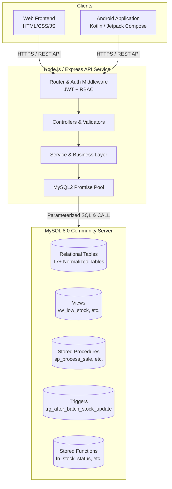

# PharmaCare System Architecture

## 1. System Overview

**PharmaCare** is a mid-scale pharmacy management system designed for engineering college DBMS coursework and practical demonstration. It provides a multi-client relational platform consisting of:
1. **Responsive Web Frontend**: Vanilla HTML5/CSS3/JavaScript preserving the reference UI design.
2. **Native Android Application**: Kotlin + Jetpack Compose with Material 3.
3. **Unified Backend API**: Node.js + Express.js with connection pooling, JWT authentication, and RBAC.
4. **Authoritative Relational Database**: MySQL 8.0 LTS enforcing 3NF normalization, ACID transactions, stored procedures, triggers, views, and functions.



---

## 2. Architectural Boundaries & Data Flow

### 2.1 Separation of Concerns
- **Zero Direct Database Access**: Neither the web client nor the mobile app connects directly to MySQL. All queries execute through authenticated Express REST endpoints.
- **Single Source of Truth**: MySQL is the sole authoritative state store. No local SQLite, Firestore, or in-memory arrays act as persistent data.
- **Shared Business Logic in Database**: Critical operations such as inventory decrementing, expiry checking, and transaction rollbacks are housed inside MySQL stored procedures (`sp_process_sale`) and triggers. This guarantees that whether an invoice is billed via the Web cashier interface or the Android POS screen, identical database constraints and concurrency safeguards apply.

### 2.2 Monorepo Layout
```text
PharmaCare/
├── source-ui/                  # Preserved reference HTML UI backup
│   └── PharmaCare – Pharmacy Management.html
├── web/                        # Production web application
│   ├── index.html              # Clean semantic markup
│   ├── css/                    # Preserved styles and design tokens
│   ├── js/                     # Modular client-side controllers and API services
│   └── assets/                 # Icons and media
├── backend/                    # Express.js REST API
│   ├── src/
│   │   ├── config/             # Database pool and environment configuration
│   │   ├── middleware/         # Auth, RBAC, error handlers, rate limiting
│   │   ├── routes/             # REST endpoint definitions
│   │   ├── controllers/        # Request parsing and HTTP responses
│   │   ├── services/           # Business logic and transaction orchestration
│   │   └── repositories/       # Parameterized SQL database queries
│   ├── package.json
│   └── .env.example
├── database/                   # MySQL schema, seeds, routines and demos
│   ├── 01_schema.sql           # Table definitions, PK/FK, CHECK constraints
│   ├── 02_seed.sql             # Realistically populated seed records
│   ├── 03_views.sql            # Aggregated report views
│   ├── 04_functions.sql        # Deterministic and calculation functions
│   ├── 05_triggers.sql         # Audit and validation triggers
│   ├── 06_procedures.sql       # Atomic transaction stored procedures
│   ├── 07_indexes.sql          # Query performance indexes and EXPLAIN plans
│   ├── 08_dbms_demo.sql        # Executable viva and concept demo queries
│   └── setup.sql               # Automated master setup and provisioning script
├── android/                    # Native Android Studio Project
│   └── PharmaCareAndroid/      # Kotlin + Jetpack Compose application
├── docs/                       # Architecture, ER diagram, DBMS concepts, testing
├── .agents/skills/             # Agentic workflows and testing skills
├── AGENTS.md                   # Engineering principles and project constraints
└── README.md                   # Setup guide and faculty review documentation
```

---

## 3. Security & Access Control

### 3.1 Authentication & Authorization
- **Password Protection**: Passwords stored as one-way salted hashes using `bcrypt` (cost factor 10).
- **Sessionless Auth**: Stateless JSON Web Tokens (JWT) signed with HMAC-SHA256 containing user ID, username, and role ID.
- **Role-Based Access Control (RBAC)**:
  - **Administrator (Role 1)**: Full system access, employee management, system audits, financial reporting.
  - **Pharmacist (Role 2)**: Medicine catalog management, batch entries, prescription verification, sales, inventory.
  - **Cashier (Role 3)**: POS billing, customer record creation, invoice re-printing.
  - **Inventory Manager (Role 4)**: Purchase orders, supplier tracking, batch adjustments, returns.

### 3.2 Database Hardening
- **Least-Privilege Database User**: An isolated application user `pharmacare_user` is provisioned with `SELECT`, `INSERT`, `UPDATE`, `EXECUTE` privileges on `pharmacare_db`, restricting schema alteration and administrative operations during runtime.
- **SQL Injection Prevention**: All queries use parameterized placeholders (`?`) via the `mysql2/promise` driver.

---

## 4. Concurrency & Transaction Management

- **Row-Level Locking**: Concurrent checkout operations for the same batch utilize `SELECT ... FOR UPDATE` inside `sp_process_sale`.
- **Atomic Operations**: Sales and purchases operate under `START TRANSACTION`. If any batch has insufficient quantity or has expired, MySQL emits a signal and triggers a `ROLLBACK`, guaranteeing zero partial invoices or corrupted stock counts.
- **Stock Floor**: Enforced by engine-level `CHECK (quantity >= 0)` constraint on the `batch` table.
