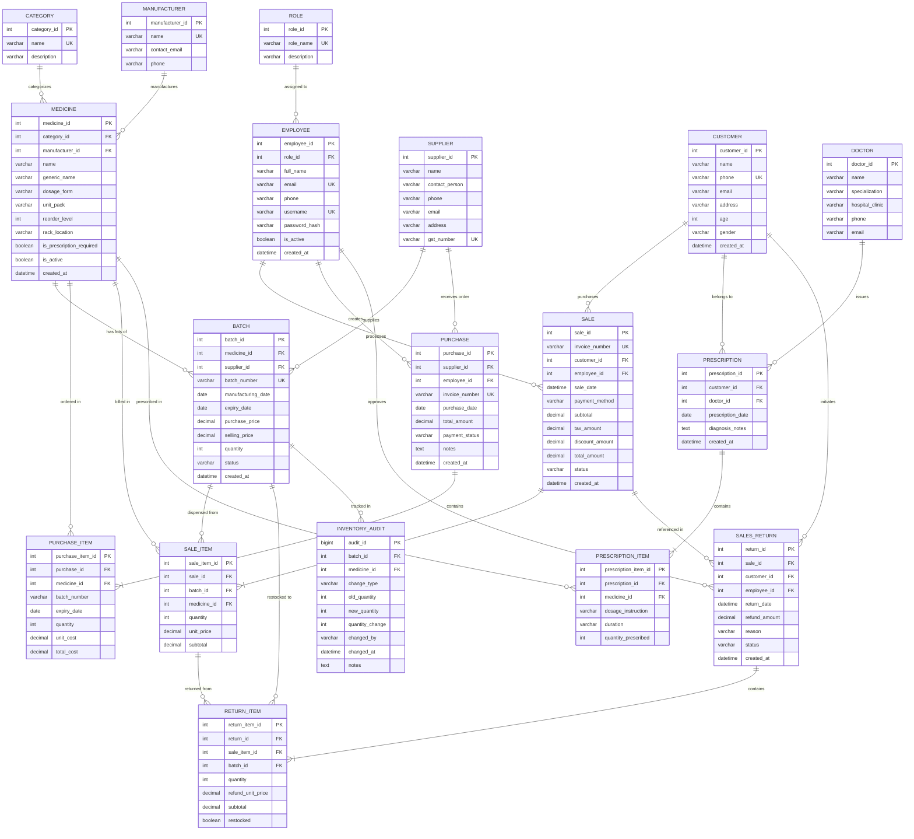

# PharmaCare Entity-Relationship (ER) Model

This document specifies the relational model, cardinalities, primary keys, foreign keys, and structural integrity constraints of the **PharmaCare** database.

## 1. Mermaid Entity-Relationship Diagram

---

## 2. Cardinalities and Relational Semantics

| Parent Entity | Child Entity | Cardinality | Business Meaning |
| :--- | :--- | :--- | :--- |
| `CATEGORY` | `MEDICINE` | 1 to Many (1:N) | A category groups multiple medicines; every medicine belongs to exactly one category. |
| `MANUFACTURER` | `MEDICINE` | 1 to Many (1:N) | A pharmaceutical manufacturer produces multiple medicines. |
| `MEDICINE` | `BATCH` | 1 to Many (1:N) | A medicine has multiple production batches with distinct expiration dates. |
| `SUPPLIER` | `BATCH` | 1 to Many (1:N) | A supplier delivers batches of medicines. |
| `SUPPLIER` | `PURCHASE` | 1 to Many (1:N) | A supplier receives multiple purchase order invoices. |
| `PURCHASE` | `PURCHASE_ITEM` | 1 to Many (1:N) | A purchase order invoice contains one or more line items. |
| `CUSTOMER` | `SALE` | 1 to Many (1:N) | A customer may make zero, one, or multiple purchases over time. |
| `EMPLOYEE` | `SALE` | 1 to Many (1:N) | A cashier/pharmacist processes multiple sales bills. |
| `SALE` | `SALE_ITEM` | 1 to Many (1:N) | An invoice bill consists of one or more purchased batch items. |
| `BATCH` | `SALE_ITEM` | 1 to Many (1:N) | Units from a specific batch can be sold across multiple customer sales. |
| `DOCTOR` | `PRESCRIPTION` | 1 to Many (1:N) | A doctor writes prescriptions for patients. |
| `CUSTOMER` | `PRESCRIPTION` | 1 to Many (1:N) | A patient/customer can have multiple prescription records. |
| `PRESCRIPTION` | `PRESCRIPTION_ITEM`| 1 to Many (1:N) | A prescription includes multiple prescribed medicines with dosages. |
| `SALE` | `SALES_RETURN` | 1 to Many (1:N) | An invoice may have an associated return record for damaged/refunded items. |
| `SALES_RETURN` | `RETURN_ITEM` | 1 to Many (1:N) | A return transaction details individual items and quantities returned. |
| `BATCH` | `INVENTORY_AUDIT` | 1 to Many (1:N) | Every stock alteration on a batch produces an immutable audit record via triggers. |

---

## 3. Key Constraints & Data Integrity

1. **Primary Keys**: Every table uses a surrogate integer auto-increment key (`INT AUTO_INCREMENT PRIMARY KEY`) or composite business unique constraint.
2. **Foreign Key Integrity**:
   - `ON DELETE RESTRICT` on master tables (`medicine`, `customer`, `employee`, `supplier`) to prevent accidental deletion of referenced entities.
   - `ON DELETE CASCADE` for line items (`purchase_item`, `sale_item`, `prescription_item`, `return_item`) linked strictly to their parent transaction header if headers are purged during cleanups.
3. **Check Constraints**:
   - `batch.quantity >= 0`: Ensures stock never becomes negative under any circumstance.
   - `batch.purchase_price >= 0` and `batch.selling_price >= 0`: Prevents invalid prices.
   - `purchase_item.quantity > 0` and `sale_item.quantity > 0`: Disallows zero or negative quantity line items.
4. **Unique Constraints**:
   - `UNIQUE (medicine_id, batch_number)`: Enforces batch identity per medicine.
   - `UNIQUE (sale_id, batch_id)`: Prevents duplicate line items for the same batch on a single invoice.
   - `employee.username`, `employee.email`, `customer.phone`: Enforce uniqueness.
